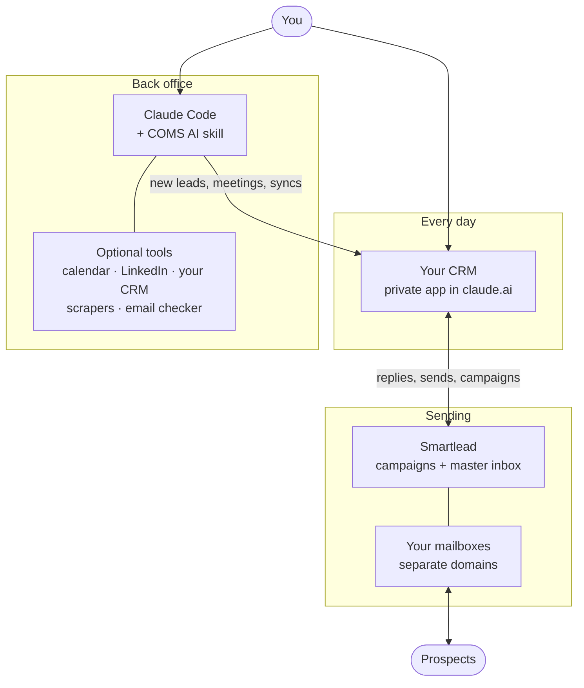

# COMS AI

**AI Cold Outbound Management System.** A Claude Code skill that sets up and runs cold outbound for your business: sending infrastructure, a reply agent that writes in your voice, lead-finding agents, and your own private CRM and master inbox, all inside Claude.

Built for solo founders and people running marketing or outbound at small businesses. Agencies can use it too: it supports more than one business.

## Requirements

- **Claude Code.** Built mainly for the Code tab in the Claude desktop app. The command-line version works too.
- **A claude.ai plan that includes artifacts** and custom connectors.
- **A Smartlead account** for sending and the master inbox. (Other sending tools can be used for parts of the system, but will require an overhaul of the system which can be instructued via Claude Code)
- **Separate domains and mailboxes** for cold email. The skill helps you plan and set these up.

## Install

Pick one option. Both put the skill in `~/.claude/skills/coms-ai`.

### Option A: download the zip

1. Download `coms-ai.zip` from the [Releases page](https://github.com/codillybts/coms-ai/releases), or use the green "Code" button, then "Download ZIP".
2. Unzip it.
3. Rename the unzipped folder to `coms-ai` if it has a different name.
4. Move it to `~/.claude/skills/coms-ai`. (On a Mac, in Finder press Cmd+Shift+G and type `~/.claude/skills`. Create the `skills` folder if it does not exist.)
5. Check that `~/.claude/skills/coms-ai/SKILL.md` exists.

### Option B: git clone

```bash
git clone https://github.com/codillybts/coms-ai ~/.claude/skills/coms-ai
```

COMS AI never connects to GitHub and never checks for updates. Once it's in your skills folder, it's just files, and your copy keeps working as is.

## Set it up

1. Make a folder for your outbound work, for example `~/Documents/COMS AI`.
2. Open Claude Code in that folder.
3. Say: **set up COMS AI**

Claude then walks you through seven steps. You can stop at any point and pick up later; your answers are saved in `coms-profile.json` in that folder.

| Step | What happens | About |
|---|---|---|
| 1. Interview | Short rounds of questions with clickable answers: your business, ideal customer, offer and proof, tools, goals, voice, territory, compliance, team and branding. Skip anything, or say "decide for me". Nothing is built until you confirm the summary. | 20 to 40 min |
| 2. Infrastructure | Works out how many domains and mailboxes you need from your daily lead target, explains SPF, DKIM and DMARC in plain words, and sets a safe warmup timeline (about 3 weeks). Suggests Smartlead and InboxKit, or keeps the tools you already have. | 10 min, then warmup |
| 3. Connect Smartlead | Adds Smartlead's official connector to Claude, so Claude and your CRM can read replies and send on your behalf. | 5 min |
| 4. Your voice | Share past emails, call notes or a Gmail or Outlook export. Claude studies them and writes your voice rules. Or start from built-in best-practice rules. | 10 min |
| 5. Build the CRM | Publishes your private CRM in claude.ai with your name, logo and colors. It starts empty. | 5 min |
| 6. First leads | Import a list, add leads by hand, or let Claude's agents find them. | Varies |
| 7. Handoff | Your daily routine, optional scheduled jobs (morning brief, lead searches), and how to change anything. | 5 min |

API keys (an email checker, data tools) go in a local `.env` file, never in the CRM or the profile. If you want anything changed at any point, just ask.

## How the system works

COMS AI has three parts that work together:

- **Your CRM** is a private web app inside claude.ai. It's where you work every day: replies, leads, campaigns, the pipeline, the map. It talks to Smartlead directly and asks Claude to draft emails for you.
- **Smartlead** is the engine. It sends your campaigns from your mailboxes, warms them up, and collects every reply in one master inbox.
- **Claude Code** is the back office. This is where the skill lives. It runs the setup, the lead-finding agents and the syncs with your other tools, and it changes anything you ask for.



### Finding leads

1. In the CRM, click **Find leads** and describe who you want. It's pre-filled from your ideal customer.
2. In Claude Code, say **run my lead searches**. Claude splits the work across research agents that look through public websites, directories, registries, news and job posts, plus any data tools you connected.
3. Agents only save an email they actually found published, with the link to where it was. They never guess or build one from a name. Each lead comes with why it fits, a real fact about it, and its location for the map.
4. The leads appear in the CRM under **Leads**, and on **Map View** if their address is published.

You can also import a CSV or Excel file, or add people by hand.

### Writing and sending the first emails

1. Pick leads and press **Write first emails**. Claude writes a first email and two follow-ups for each one, using your voice rules and one real fact about that lead.
2. Every email gets automatic checks: length, subject, no links in the first email, no banned words, a real fact used. You approve, edit or reject each one.
3. **Add approved to a campaign** sends them to a Smartlead campaign, where each lead gets their own personal emails.
4. Smartlead sends on your schedule from your warmed-up mailboxes, in plain text, with open tracking off. It stops as soon as someone replies.

### Handling replies

1. Every reply from every mailbox lands in the CRM **Inbox**.
2. Claude sorts each one (interested, question, not now, referral, not interested, out of office, unsubscribe) and drafts an answer in your voice, using only facts from your business profile.
3. You read it, edit it if you want, and click **Send**. It goes out from the same mailbox, in the same thread.
4. Rules handle the routine work: interested replies move to your pipeline and get a 1-hour task, "not now" replies get a reminder on the date they gave, and unsubscribes go on Do not contact everywhere.
5. **Nudges** follow up with interested people who went quiet: one after 3 days, one after 7, each adding something new.

### Tracking deals

Replies become deals in the **Pipeline**, with values and a weighted forecast. If you connect your calendar, meetings with leads show up on their own, with a short prep note before each call. **Analytics** shows sends, replies, positive replies and which campaigns win.

### Optional extras

All of these are off unless you set them up:

- **LinkedIn:** HeyReach or GojiBerry, or your own AI SDR.
- **Inbound:** for people who contact you first.
- **Your current CRM:** keep it in sync.
- **An email checker:** test addresses before sending.
- **Teammates:** on a Claude Team or Enterprise plan.

Claude connects each one with you, then syncs it into the CRM whenever you say "sync" or on a schedule.

### What stays in your control

- **Nothing sends without your click.** The one optional exception is a polite one-line thank-you to "not interested" replies, which you have to turn on.
- **Nobody is emailed until you approve.** You approve their emails and add them to a campaign yourself.
- **No guessed emails, no guessed locations, no invented facts.**
- **Emails are only labeled Valid or Risky after a real checker tests them.**
- **Your data stays private.** It lives in your private claude.ai app and your Smartlead account. COMS AI has no server of its own.

## The CRM, page by page

- **Business switcher** at the top of the menu. Add more businesses any time, or view them all at once.
- **Home:** what needs you now, your numbers, and setup progress.
- **Inbox:** replies, nudges and sent emails, each reply with an AI draft. Also **Compose** for one-off emails.
- **Inbound:** people who reached out to you first. Only shows if you turn it on.
- **Leads:** add, import (CSV or Excel, with column matching), and **Find leads**.
- **Map View:** a live map of your territory. Click a state, then a county, then any lead.
- **First emails:** the approval queue for new emails.
- **Campaigns:** create, launch, pause and resume Smartlead campaigns.
- **Pipeline:** deals by stage. Drag to move them.
- **Calendar:** meetings with leads, with prep notes.
- **Contacts** and **Tasks** (including the automation rules).
- **Analytics:** results over 30 days.
- **Mailboxes:** health, warmup and daily limits.
- **Reply agent:** your tone, rules and banned words.
- **LinkedIn:** only if you do LinkedIn outreach.
- **Do not contact:** blocked people and domains, also blocked in Smartlead.
- **Settings:** brand, sending, inbound, pipeline, businesses, team, connections, and an Instructions tab.

## Things to say in Claude Code

| Say | What it does |
|---|---|
| "set up COMS AI" | Starts setup, or picks up where you left off |
| "run my lead searches" | Runs every search you queued in the CRM |
| "check my leads" | Runs your email checker on new leads |
| "sync my calendar" / "sync LinkedIn" / "sync inbound" / "run my jobs" | Pulls your other tools into the CRM |
| "set up manual sends" | Creates the campaign that Compose and inbound replies send through |
| "rebuild my voice rules" | Rewrites your voice rules from emails you share |
| "set up my new business" | Runs the setup questions for another business |
| "give me my morning brief" | A short summary of what needs you today |

Anything else, just ask. Whatever you want changed gets changed.

## What is in this repo

```
SKILL.md                    The skill: intro, phases, hard rules
references/                 Detailed steps Claude reads when needed
  intake-interview.md       Every setup question and the profile format
  infrastructure.md         Domains, mailboxes, warmup, sizing calculator
  connect-smartlead.md      Adding the Smartlead connector
  voice-and-reply-agent.md  Voice rules, default writing rules, reply agent
  build-the-crm.md          How the CRM is published and filled in
  sync-jobs.md              What Claude writes into the CRM for each job
  crm-guide.md              How the CRM works (also the in-app Instructions)
  lead-sourcing.md          Imports and the lead-finding agents
  map-view.md               Territory questions and how Map View works
  extras.md                 Calendar, inbound, current CRM, team
  linkedin.md               LinkedIn: HeyReach, GojiBerry, own AI SDR
  compliance.md             Plain-language overview of cold email laws
  operations.md             Daily routine, scheduled jobs, troubleshooting
assets/
  app.html                  The CRM template
  profile.schema.json       Format of coms-profile.json
  vendor/                   Bundled libraries (d3, topojson, SheetJS)
  maps/                     Map data for Map View
```

## Affiliate disclosure

COMS AI may recommend tools during setup using affiliate links: Smartlead, InboxKit, HeyReach, and GojiBerry (HeyReach and GojiBerry only if you do LinkedIn outreach). If you sign up through these links, the project may earn a commission at no extra cost to you. Every recommendation comes with an "I already have my own / I use a different service" option. By downloading and using this skill, you agree to these terms. This helps us keep the project free of charge. 

## No liability

The AI behind this skill can make mistakes. Check every email and reply before you send it. By downloading and using this skill, you accept that its authors and contributors claim no liability for anything that results from using it with Claude or any other AI tool. You are responsible for following email, privacy, and anti-spam laws where you and your prospects are, and the terms of every tool you use. Nothing in this skill is legal advice. See [DISCLAIMER.md](DISCLAIMER.md).

## License

MIT. See [LICENSE](LICENSE).

## Credits

Map View uses map data from [US Atlas](https://github.com/topojson/us-atlas) (ISC license, based on US Census Bureau boundaries) and [World Atlas](https://github.com/topojson/world-atlas) (ISC license, based on Natural Earth), drawn with [d3](https://d3js.org) 7.9.0 (ISC) and [topojson](https://github.com/topojson/topojson) 3.0.2 (ISC). Excel imports use [SheetJS](https://sheetjs.com) 0.18.5 (Apache 2.0). All three are bundled in `assets/vendor/` so nothing is downloaded at run time.
